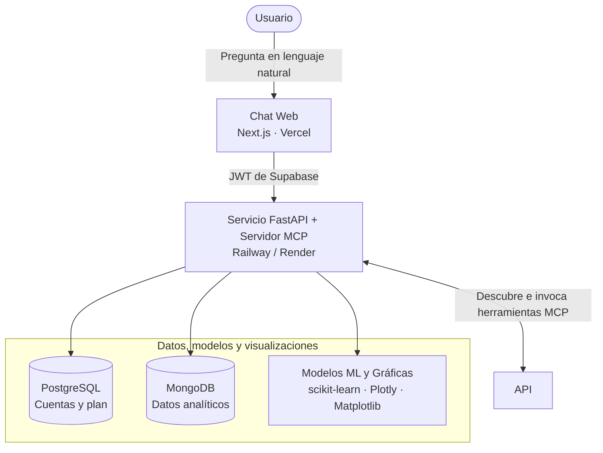

# DuoBot Campus

### Dos asistentes de IA que convierten los datos del campus en decisiones

Un chatbot para analizar a los **estudiantes** y otro para la **gestión administrativa**.  
Preguntas en lenguaje natural, respuestas con gráficas y modelos de machine learning.

  
  
  

  <a href="#qué-es">¿Qué es?</a> ·
  <a href="#cómo-funciona">Cómo funciona</a> ·
  <a href="#tecnologías">Tecnologías</a> ·
  <a href="#estado-del-proyecto">Estado</a> ·
  <a href="#cómo-revisar">Cómo revisar</a> ·
  <a href="#equipo">Equipo</a> ·
  <a href="#enlaces">Enlaces</a>

---

## ¿Qué es?

**DuoBot Campus** es un proyecto integrador de *Programación Lógica y Funcional* (Unidad 4).  
Está conformado por **dos aplicaciones web independientes**, cada una con un chatbot como interfaz principal:

<table>
  <tr>
    <td width="50%" valign="top">
      <h3>DuoBot Estudiantes</h3>
      
<strong>Para quién:</strong> Personal académico y tutores

      
<strong>Qué responde:</strong> Desempeño académico, riesgo de deserción y perfiles de estudiantes

      
<strong>Cómo responde:</strong> Consultas, gráficas y modelos de ML sobre datasets

    </td>
    <td width="50%" valign="top">
      <h3>DuoBot Administrativo</h3>
      
<strong>Para quién:</strong> Personal administrativo

      
<strong>Qué responde:</strong> Operación, recursos, matrícula e indicadores administrativos

      
<strong>Cómo responde:</strong> Consultas, gráficas y modelos de ML sobre datasets

    </td>
  </tr>
</table>

> [!NOTE]
> El usuario escribe una pregunta en lenguaje natural; el chatbot decide qué herramienta usar y responde con datos reales y autorizados: una **tabla**, una **gráfica** o la **predicción de un modelo**.

---

## Cómo funciona

### Principios de arquitectura

- **MCP como punto central:** El modelo de IA descubre y llama herramientas que consultan el contexto de la aplicación, la cuenta del usuario autenticado y las dos bases de datos.
- **Permisos validados en el servidor:** Cada herramienta valida al usuario del lado del servidor; el chat nunca decide los permisos.
- **Plan gratuito y premium:** Gestión de planes con pagos en modo de prueba mediante Stripe.

---

## Tecnologías

| Capa | Herramientas |
| :--- | :--- |
| **Frontend** |   |
| **Backend e IA** |   |
| **Bases de datos y ORM** |    |
| **Datos, ML y gráficas** |     |
| **Auth y pagos** |   |
| **Infraestructura** |     |

---

## Estado del proyecto

- [x] Estructura base del monorepo
- [x] Autenticación con Supabase Auth y validación de JWT y roles en el backend
- [x] PostgreSQL para perfiles, roles, planes y suscripciones. MongoDB para los datos analíticos sintéticos de cada proyecto.
- [x] Tres herramientas MCP del avance 2 por proyecto. Ambos incluyen `get_user_profile` y `get_subscription_status`. Estudiantes incluye `query_dataset_summary` y Administrativo, `query_admin_indicators` (rol `admin`).
- [x] Chat autenticado que descubre e invoca herramientas MCP con Claude
- [x] Stripe en modo de prueba con Checkout, portal y webhook firmado que actualiza el plan
- [x] CI para ambos servicios y ambos frontends, con ejecución en verde verificada en el [PR #5](https://github.com/jesyanahi1685-stack/DuoBot-Campus/pull/5)
- [ ] Adjuntar capturas y reportes de humo por proyecto y registrar el flujo integrado con Supabase, Claude, MongoDB y Stripe en un entorno de prueba
- [ ] Completar el mínimo de seis herramientas MCP por proyecto y los modelos de ML para el avance 3
- [ ] Despliegue en producción

---

## Cómo revisar

Recorrido de cinco minutos con el entorno de prueba configurado. Para prepararlo desde cero, sigue la [guía técnica](docs/README_TECNICO.md).

1. **Minuto 1.** Abre Estudiantes y Administrativo. Inicia sesión con una cuenta de prueba en cada app. Usa una cuenta con rol `admin` para consultar indicadores administrativos. [Estudiantes local](http://localhost:3000) · [Administrativo local](http://localhost:3001).
2. **Minuto 2.** En Estudiantes, pregunta «¿Cuál es el resumen académico de los estudiantes del dataset?». En Administrativo, pide indicadores de un año que esté incluido en los datos sembrados. El recorrido de chat requiere Claude configurado. [Flujo del chat](docs/AUTH_Y_CHAT.md#flujo).
3. **Minutos 3 y 4.** Desde una cuenta de prueba con plan gratuito, abre **Mejorar a Premium**, completa Checkout con una tarjeta de prueba y comprueba la entrega del webhook y el cambio de plan. [Guía de Stripe](docs/PAGOS_STRIPE.md#probar-en-local).
4. **Minuto 5.** Revisa las comprobaciones de CI y el índice de evidencia. La guía técnica incluye el procedimiento de humo para repetir las comprobaciones de API en ambos servicios. [CI](https://github.com/jesyanahi1685-stack/DuoBot-Campus/pull/5/checks) · [Prueba de humo](docs/README_TECNICO.md#11-prueba-de-humo-de-estudiantes-y-administrativo) · [Evidencia](docs/evidencia/README.md).

---

## Equipo

| Integrante | Proyecto |
| :--- | :--- |
| _Jessika Diaz 23480898_ | DuoBot Estudiantes |
| _Yudel Gonzales 23481438_ | DuoBot Estudiantes |
| _Miranda Alvarez 23480831_ | DuoBot Administrativo |
| _Diego Mireles 23481455_ | DuoBot Administrativo |

---

## Enlaces

| Recurso | Acceso |
| :--- | :--- |
| **Demo Estudiantes** | <https://estudiantes-theta.vercel.app> |
| **Demo Administrativo** | <https://admin-beta-tan-43.vercel.app> |
| **Documentación técnica** | [`docs/README_TECNICO.md`](docs/README_TECNICO.md) |

> [!TIP]
> Para levantar el proyecto en local, consulta la [documentación técnica](docs/README_TECNICO.md).

---

  <a href="#duobot-campus">↑ Volver arriba</a>

